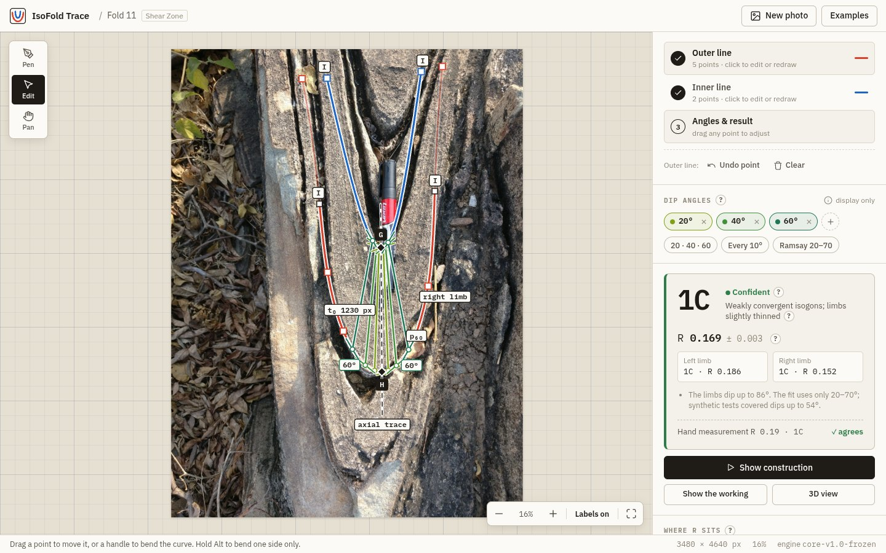

# IsoFold Trace

**Classify a geological fold from a photo with Ramsay's dip-isogon method.** Trace the two edges of one bed on a field photo; IsoFold draws the dip isogons, measures the thickness at every dip angle and gives the Ramsay class (1A, 1B, 1C, 2 or 3), live as you edit the lines.



## What it does

- **Trace with a pen tool, as in CorelDraw or Photoshop.** Click to place points, drag to bend the curve, drag points later to adjust. Zoom and pan on full-resolution photos.
- **Live result.** As soon as both edges are traced, the frozen IsoFold geometry engine measures the bed:
  - hinge points H and G, the axial trace, and the inflection points
  - isogons at the dip angles you choose, labelled p_α / q_α
  - t₀, t′α and T′α, and R from the thickness law t′α = R + (1 − R) cos α
  - the Ramsay class, with "confident" or "low confidence" and the reasons in plain words
- **Results panel.** Class card, where R sits among the classes, the Ramsay t′α–α diagram, and a table at your chosen angles.
- **Show construction.** An animation that replays the hand method on the photo: rulers on the hinge tangents, t₀, turning the ruler to α, touching the outer and inner edge, the isogon, t_α, and the point on the diagram.
- **Show the working.** The full calculation, typeset in LaTeX: t₀, the table (α, cos α, t_α, T_α, t′α, T′α, R_α), R = A/(A + B) and the class rule that applies.
- **"?" help** on every technical term.
- **3D view.** The traced bed carried along the fold axis behind the photo, with hinge lines, axial plane and isogon planes (an illustration assuming a cylindrical fold).
- **12 field examples** traced by hand in CorelDraw. Three of them come with the hand-measured t′α tables, and the app shows its numbers next to them.

The photo never leaves your computer: only the traced points are sent to the local Python engine.

**Agreement with hand measurement (Fold 11):**

| | 30° | 45° | 60° | 70° | R | Class |
|---|---|---|---|---|---|---|
| Hand (CorelDraw) | 0.879 | 0.751 | 0.577 | 0.462 | 0.186 | 1C |
| IsoFold Trace (left limb) | 0.892 | 0.759 | 0.591 | 0.473 | 0.186 | 1C |

The full development log, the validation and all figures are in [docs/07_ISOFOLD_TRACE_WEB_APP.md](docs/07_ISOFOLD_TRACE_WEB_APP.md).

## Installation

**You need:**
- **Python 3.11 or newer** (tested with 3.13)
- **Node.js 20 or newer** (only to build the web pages)

### Linux / macOS

```bash
git clone https://github.com/sogalabhi/IsoFold.git
cd IsoFold

# 1. Python virtual environment
python3 -m venv .venv
source .venv/bin/activate
pip install --upgrade pip
pip install -r app/backend/requirements.txt
pip install -e foldclass            # the frozen geometry engine

# 2. Web app (one-time build)
cd app/web
npm install
npm run build
cd ../..

# 3. Run
app/run.sh                          # → open http://localhost:8765
```

### Windows (PowerShell)

```powershell
git clone https://github.com/sogalabhi/IsoFold.git
cd IsoFold
python -m venv .venv
.venv\Scripts\Activate.ps1
pip install --upgrade pip
pip install -r app\backend\requirements.txt
pip install -e foldclass

cd app\web; npm install; npm run build; cd ..\backend
python -m uvicorn api:app --host 127.0.0.1 --port 8765   # → open http://localhost:8765
```

`app/run.sh` rebuilds the web pages automatically when their source has changed. To use another port: `PORT=9000 app/run.sh`.

### Example folds (optional)

The 12 hand-traced field examples are read from a dataset folder that is **not** in this repository (photos and decoded CorelDraw traces, about 175 MB). By default the app looks for `../dataset/traces` next to the repo. To point it elsewhere:

```bash
export ISOFOLD_TRACES=/path/to/dataset/traces   # contains boundaries/ and photos/
```

Without the dataset the app still works: open your own photo and trace it.

## Using it

1. **Open a photo**, or click an example card.
2. **① Outer line:** with the Pen, click along the outer edge of one bed, past the hinge and down both limbs. Drag while clicking to bend the curve. Press **Done**, or click the last point again.
3. **② Inner line:** trace the inner edge of the same bed the same way.
4. **③ Result:** the class appears and the isogons are drawn. Pick dip angles with the chips or presets. Drag any point with **Edit** and the result updates live.
5. Use **Show construction**, **Show the working** and **3D view** to explain the result. **Esc** closes any of them.

Tip: `http://localhost:8765/#example=Fold_11` opens an example directly.

## Tests

```bash
source .venv/bin/activate
cd app/backend && python -m pytest tests -q     # app: 10 tests
cd ../../foldclass && python -m pytest -q       # frozen engine
```

## Project layout

```
app/
  run.sh              start the app (API + built web pages) on :8765
  backend/
    api.py            FastAPI: /api/classify, /api/examples, /api/health
    manual.py         traced lines → class, R, isogons, verdict (uses the frozen engine)
    bezier.py         pen-tool paths ↔ points (24 samples per segment, as CorelDraw)
    examples.py       the 12 field examples and their hand-measured t′α tables
    pairing.py, prepare.py, pipeline.py   shared preparation steps (cut to one fold, same direction, thin)
    tests/            test_manual.py, test_api.py
  web/                React + TypeScript + Vite front end
foldclass/            frozen geometry engine core-v1.0 (spline fit, tangent angles, isogons, R fit, class)
docs/                 documentation; chapter 7 is this app
```

## How the classification works (short)

For each dip angle α (the angle between the layer's tangent and the hinge tangent), the engine finds p on the outer edge and q on the inner edge where both edges dip α. It measures the orthogonal thickness t_α between the two parallel tangents and normalises it, t′α = t_α / t₀. It fits t_α = A + B cos α over α = 20°–70° every 2.5° on each limb, so R = A / (A + B). Then:

| R | > 1 | ≈ 1 | 0 – 1 | ≈ 0 | < 0 |
|---|---|---|---|---|---|
| Class | 1A | 1B | 1C | 2 | 3 |

"≈" means within ±0.05, or ±2σ of R if that is larger. Background and proofs: [docs/01_GEOLOGY_FUNDAMENTALS.md](docs/01_GEOLOGY_FUNDAMENTALS.md) and [docs/06_IN_DEPTH_MATHEMATICAL_PROOFS_AND_CODE_WALKTHROUGH.md](docs/06_IN_DEPTH_MATHEMATICAL_PROOFS_AND_CODE_WALKTHROUGH.md).

---

## Experimental (not part of the app)

These parts of the repository are research work in progress. They are **not** used by IsoFold Trace and are not validated for field use.

- **Automatic boundary detection** (`app/backend/detect.py`, `pairing.py`, `pipeline.py`, `render.py`): classical structure-tensor edge tracing and automatic pairing of bed boundaries. It found a usable pair on 2 of 26 field photos.
- **SAM segmentation trial** (`app/backend/segment.py`): pretrained Segment Anything did not isolate single beds. A trained segmentation model (U-Net/SegFormer) is the planned next step, using beds traced in this app as labels.
- **Older desktop and command-line tools** (`tools/trace.py`, `tools/run.py`, `tools/orientation_isogons.py`, `tools/sweep.py`, `tools/sensitivity.py`, `trace_and_measure.py`).
- **Plans described in the docs** (Fourier shape analysis, C++ engine, mobile app): see [docs/05_FUTURE_ROADMAP_AND_MOBILE_APP.md](docs/05_FUTURE_ROADMAP_AND_MOBILE_APP.md).
- **Engine design notes:** the previous README, with the critical design decisions that the engine's code comments refer to as "Readme.md", is kept at [docs/ENGINE_DESIGN_NOTES.md](docs/ENGINE_DESIGN_NOTES.md).
