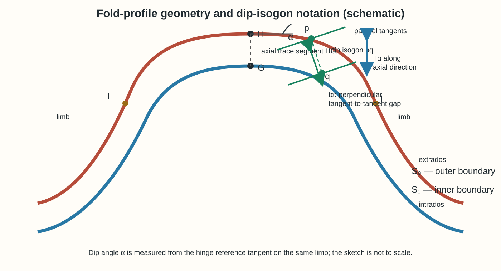
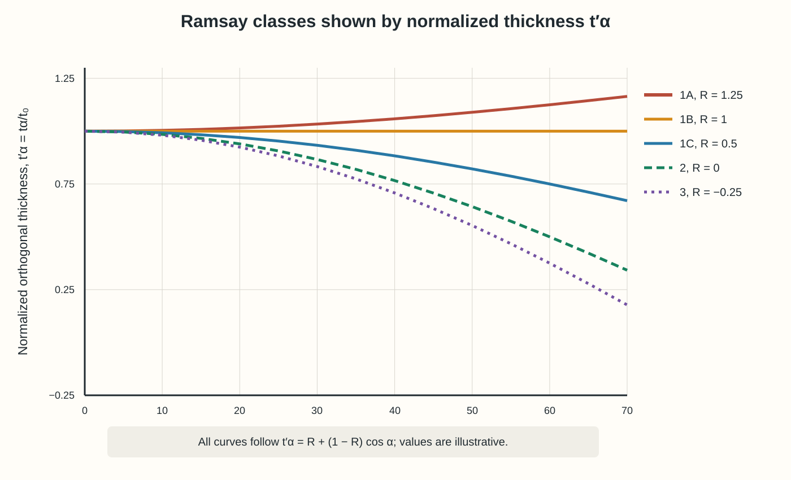

# Chapter 2 — Theoretical Background and Literature Review

This chapter introduces the fold-profile geometry and notation used by the project, explains the construction of dip isogons, and describes the five Ramsay classes. It then reviews image-based boundary extraction and identifies the contribution of the present work. The profile diagrams in this chapter are original explanatory schematics prepared for this report; they are not reproduced geological photographs.

## 2.1 Fold-profile geometry

A fold profile is a two-dimensional section through a folded layer. For the dip-isogon analysis used here, the layer is represented by two traced boundaries: the **outer boundary**, or extrados, and the **inner boundary**, or intrados. The surface between them is the bed whose geometry is measured.

The **hinge** is the region of greatest curvature in a fold profile. The two corresponding hinge points on the outer and inner boundaries are denoted by H and G. The **limbs** extend away from the hinge on either side. An **inflection point** is where the curvature of a boundary changes sign and marks the end of the fold segment used for a limb measurement. The line segment HG connects the corresponding hinge points and defines the axial-trace direction in the profile.

**Figure 2.1.** Fold-profile elements and notation used in this report. The sketch is schematic and not to scale. The actual engine analyzes each limb separately.

## 2.2 Notation and measured quantities

| Symbol | Meaning in this report |
|---|---|
| `S₀` | Outer traced boundary of the bed (extrados) |
| `S₁` | Inner traced boundary of the bed (intrados) |
| `H`, `G` | Corresponding hinge points on `S₀` and `S₁` |
| `HG` | Segment joining the two hinge points; establishes the axial-trace direction in the profile |
| `I` | Inflection point that bounds a limb measurement |
| `p`, `q` | Points on `S₀` and `S₁` whose tangents are parallel at the selected dip angle |
| `α` | Dip angle of a matched tangent relative to the hinge reference tangent on the same limb |
| `tα` | Orthogonal separation of the two parallel tangent lines at angle `α` |
| `Tα` | Separation of those tangent lines measured along the axial-trace direction |
| `t₀` | Fitted hinge thickness from the thickness-law fit; `t₀ = A + B` |
| `t′α` | Normalized orthogonal thickness, `tα/t₀` |
| `T′α` | Normalized axial-plane thickness, `Tα/t₀` |
| `A`, `B` | Coefficients in the fitted relation `tα = A + B cos α` |
| `R` | Ramsay thickness index, `A/(A+B)` |
| `σR` | Estimated uncertainty of the fitted `R` value |

In particular, fitted `t₀` should not be confused with the pixel distance `|HG|`. Under the ideal hinge geometry, the two are related at `α = 0°`; in the app, `t₀` is estimated jointly with `R` from the isogon measurements.

## 2.3 Dip-isogon construction and thickness law

A **dip isogon** joins a point `p` on the outer boundary to a point `q` on the inner boundary where the two boundary tangents are parallel. The construction is repeated for a range of dip angles `α` along each limb. At `α = 0°`, the matched tangent is the hinge reference tangent. At larger angles, the isogon points move down the limb toward the inflection point.

The segment `pq` is not generally perpendicular to the tangents. Therefore, the orthogonal layer thickness `tα` is the perpendicular distance between the parallel tangent lines, not necessarily the Euclidean distance `|pq|`. The axial-plane thickness `Tα` is measured along the axial-trace direction. For the ideal construction used in the Ramsay relation,

\[
\frac{t_\alpha}{T_\alpha}=\cos\alpha.
\]

The normalized thickness is

\[
t'_\alpha=\frac{t_\alpha}{t_0}.
\]

Ramsay’s thickness law can be written as

\[
t'_\alpha=R+(1-R)\cos\alpha,
\]

or, before normalization, as

\[
t_\alpha=A+B\cos\alpha,\qquad t_0=A+B,\qquad R=\frac{A}{A+B}.
\]

IsoFold fits `A` and `B` jointly from the isogon measurements on each limb. This estimates `t₀` and `R` from the whole fit rather than relying on one pixel measurement at the hinge. The classification fit uses the engine’s fixed grid from 20° to 70° at 2.5° intervals. Angles selected in the interface control displayed measurements and isogons; they do not change the classification fit grid.

## 2.4 Ramsay fold classes

Ramsay’s five classes describe how layer thickness varies around a fold. The ideal relationships below follow from the thickness law. The plotted curves in Figure 2.2 are generated from that law and illustrate the normalized orthogonal thickness as dip angle increases.

**Figure 2.2.** Idealized normalized-thickness curves from `t′α = R + (1 − R) cos α`. The plotted `R` values are illustrative examples within each ideal class range; they are not fitted field results.

| Class | Ideal `R` range | Normalized-thickness relation | Geometric interpretation |
|---|---:|---|---|
| **1A** | `R > 1` | `t′α > 1` for non-zero `α` in the ideal model | Orthogonal thickness on the limb is greater than the fitted hinge thickness; thickness increases away from the hinge. |
| **1B** | `R = 1` | `t′α = 1` | Ideal parallel/concentric fold with constant orthogonal layer thickness. |
| **1C** | `0 < R < 1` | `cos α < t′α < 1` | Intermediate behavior between the ideal 1B and Class 2 curves. |
| **2** | `R = 0` | `t′α = cos α`; `T′α = 1` | Ideal similar fold with constant axial-plane thickness. |
| **3** | `R < 0` | `t′α < cos α` | Limb thickness falls below the Class 2 relation; the class is commonly described as divergent isogons. |

These are ideal class boundaries. The software allows for measurement uncertainty around the `R = 1` and `R = 0` boundaries. It uses a boundary window equal to the larger of 0.05 or `2σR`; a value within that window is reported as Class 1B or Class 2, respectively. If the available angle coverage is insufficient or the fitted uncertainty makes the classification ambiguous, the engine may return no class rather than force a label. This operational rule should be distinguished from the ideal mathematical ranges in the table.

## 2.5 Fold descriptions versus Ramsay classes

Terms such as **antiform/synform**, **anticline/syncline**, and **open/tight/isoclinal** describe other aspects of fold geometry. They are not interchangeable with Ramsay’s thickness classes. In particular, anticline and syncline require knowledge of stratigraphic younging direction; a profile photograph alone may only support an antiform/synform description. The app’s Ramsay class describes the thickness relationship measured on a traced bed and does not infer the mechanism that formed the fold.

## 2.6 Image-based geological boundary extraction

Image-processing approaches can enhance contrast and identify edges, while semantic-segmentation approaches can classify pixels using annotated examples. In field photographs, a visually prominent edge need not be a bed boundary: fractures, weathering, vegetation, tools, and rock margins can produce competing features. An image-analysis system must also determine which two boundaries belong to the same bed before geometric classification can be applied.

In this project, classical edge tracing and pretrained Segment Anything Model (SAM) segmentation were investigated as candidate ways to reduce manual work. Their procedures and outcomes are presented in Chapters 3 and 4. Those trials motivated the current manual-tracing interface; they do not establish that all automatic approaches are ineffective.

**[SOURCE CHECK]** Add verified primary references for Ramsay’s classification and for any computer-vision or segmentation background retained in this chapter. The current report includes some candidate references, but publication details and page references need verification. Cite the source of the class definitions and state that Figures 2.1 and 2.2 are author-prepared schematics based on the cited method.

## 2.7 Research gap and project contribution

The project’s immediate contribution is an interpretable measurement tool that joins interactive manual tracing with a deterministic geometry engine. This allows fold classification to be demonstrated and compared with hand measurements while automatic boundary extraction remains unresolved. Traces created through the app may support future supervised-learning work, but model training and reliable automatic bed pairing are outside the completed implementation described in this report.
